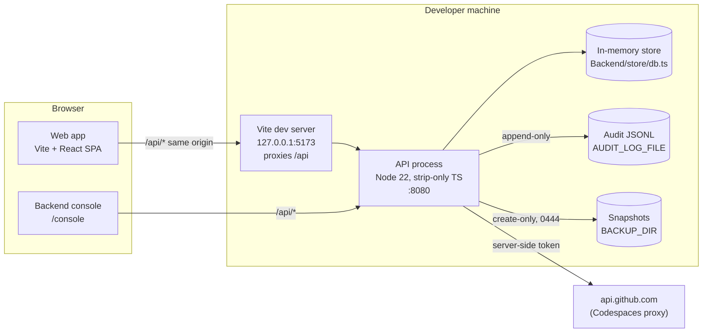
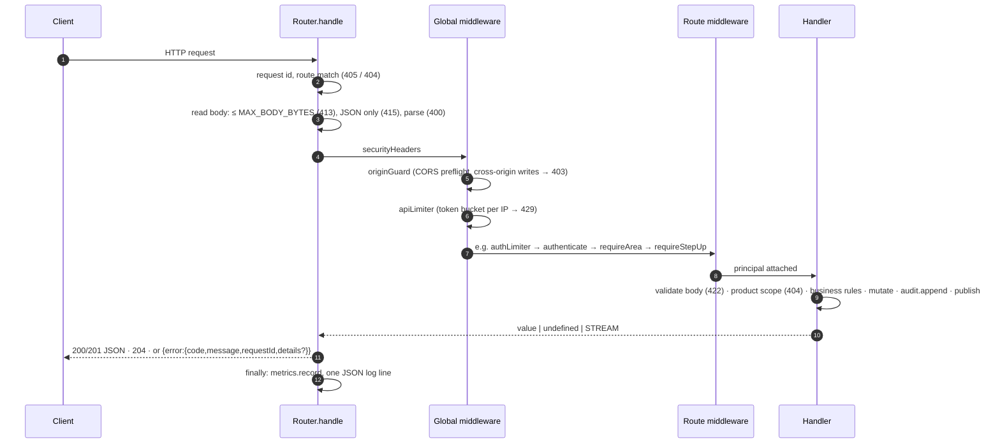
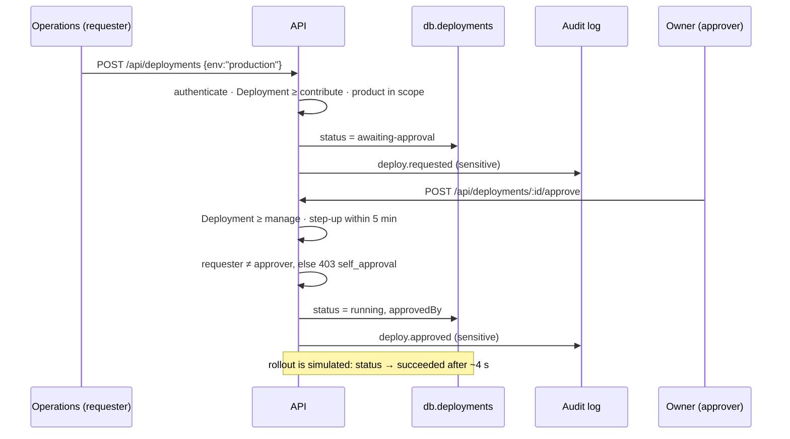
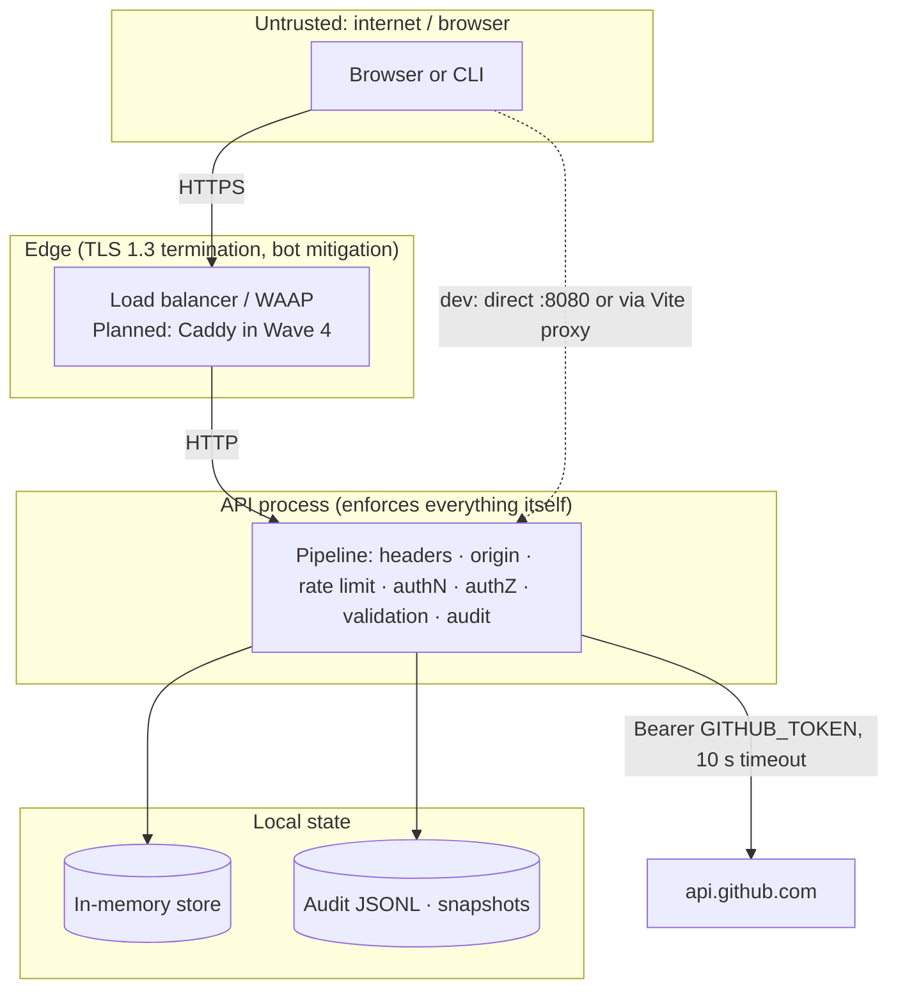
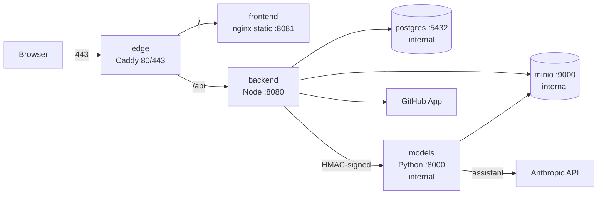

# Architecture overview

This page describes the system as the code builds it today, then the Wave 4
target topology. Decisions and their reasons are in the
[ADRs](adr/index.md).

## Components today

| Component | Where | Notes |
|---|---|---|
| API | `Backend/server.ts` | One Node process. `buildApp()` seeds the store, builds the `Router`, installs the global middleware and registers ten route modules (`Backend/routes/*.routes.ts`). No runtime npm dependencies; `Backend/package.json` lists only dev tools. |
| Router | `Backend/lib/http.ts` | A route table on top of `node:http`. Every endpoint is registered with `Router.add(method, path, meta, ...middleware, handler)`; `router.inventory()` is the API inventory, the OpenAPI document (`GET /api/openapi.json`) and the [API reference](../api/reference.md). |
| Store | `Backend/store/db.ts` | Plain `Map`s (`db.members`, `db.tasks`, …) and an array of sign-ins, seeded by `seed()` on every boot. Data does not survive a restart. Sessions and JIT grants live in their own module-level maps (`Backend/auth/sessions.ts`, `Backend/auth/jit.ts`). |
| Persistence seam | `Backend/store/collection.ts` | The Wave 4 `Collection` contract. Present but not used by any module yet. |
| Audit log | `Backend/audit/auditLog.ts` | In-memory hash chain plus an append-only JSONL file (`AUDIT_LOG_FILE`, default `./.audit/audit.jsonl`). See [Audit log](../concepts/audit-log.md). |
| Backups | `Backend/resilience/backups.ts` | JSON snapshots of the store in `BACKUP_DIR` (default `./.backups`), checksummed in `manifest.jsonl`. See [Backups and restore](../operations/backups.md). |
| Event bus | `Backend/lib/events.ts` | In-process `EventEmitter`; `GET /api/_events` streams it as Server-Sent Events. |
| Observability | `Backend/lib/logger.ts`, `Backend/lib/metrics.ts` | JSON logs to stdout/stderr with secret-key redaction and a 500-line ring buffer; per-route counters and latency percentiles. See [Monitoring](../operations/monitoring.md). |
| Backend console | `Backend/backend.html` | A single HTML page served by the API with a per-response CSP nonce. Signs in against the same API. |
| Web app | `Frontend/` | React SPA. All API traffic goes through `Frontend/src/api/client.ts`. In development Vite proxies `/api` to the API so the app and the API share an origin. |
| Models | `Models/` | A placeholder package (`Models/index.ts`, scripts that only `echo`). See [ML](../ml/index.md). |

## Request pipeline

Every request goes through the same steps, in this order
(`Router.handle` in `Backend/lib/http.ts`):

1. **Request id.** Taken from an incoming `X-Request-Id` (first 64 characters)
   or generated, and echoed in the `X-Request-Id` response header.
2. **Route match.** If the path exists but not for this method the response is
   `405 method_not_allowed` with an `Allow` header. An unknown path still runs
   the global middleware, then answers `404 not_found`. `HEAD` is served by the
   matching `GET` route without a body.
3. **Body.** For a matched route and any method other than `GET`, `HEAD` and
   `DELETE`, the body is read *before* the middleware runs: more than
   `MAX_BODY_BYTES` → `413`; a non-empty body that is not
   `application/json` → `415` (this blocks classic cross-site form posts);
   malformed JSON → `400 invalid_json`.
4. **Security headers** (`Backend/security/headers.ts`): CSP with a fresh
   nonce, `X-Content-Type-Options`, `X-Frame-Options: DENY`,
   `Referrer-Policy`, `Permissions-Policy`, COOP/CORP, `Cache-Control:
   no-store`, and HSTS in production only.
5. **Origin guard.** An `Origin` in `allowedOrigins` gets credentialed CORS
   headers. A preflight (`OPTIONS`) from any other origin is `403 bad_origin`;
   so is any non-`GET`/`HEAD` request that carries a disallowed `Origin`.
   Requests without an `Origin` (curl, server-to-server) pass, because they
   carry no ambient browser credentials.
6. **API rate limit.** A token bucket keyed by client IP
   (`Backend/security/rateLimit.ts`). See [Rate limits](../api/rate-limits.md).
7. **Route middleware**, in the order the route lists it:
   `authLimiter` (tight bucket for auth endpoints), `authenticate` or
   `authenticatePartial` (builds the principal, see
   [Sessions](../concepts/sessions.md)), `requireArea(area, level)`
   (`403 forbidden`), `requireStepUp()` (`401 step_up_required`).
8. **Handler.** Validates the body against an allow-list schema
   (`Backend/lib/validate.ts`; unknown fields are rejected), enforces product
   scope with `404` for anything out of scope, applies domain rules
   (two-person approval, no self-close, last-owner protection), mutates the
   store, appends an audit entry and publishes an event.
9. **Response.** A returned value is JSON (`200`, or `ctx.status`, e.g. `201`);
   `undefined` is `204`. Thrown `HttpError`s become the
   [error envelope](../api/errors.md); anything else becomes
   `500 internal` and the stack trace goes only to the log.
10. **Finally.** Per-route metrics are recorded and one structured log line is
    written (except for the long-lived `/api/_events` stream).

Server-level limits (`Backend/server.ts`): headers must arrive within 10 s, a
request must finish within 30 s, keep-alive is 5 s, at most 64 headers.

## Data flow: a production deploy

The two-person deploy rule touches most of the pipeline:

DevHQ records and approves deployments; it does not run them. The rollout in
`Backend/routes/operations.routes.ts` is a timer that flips `running` to
`succeeded`. The `provider` field (default `GitHub Actions`) names the CI/CD
system that would execute it.

## Trust boundaries

| Boundary | What crosses it | What protects it |
|---|---|---|
| Browser → API | Cookies, JSON bodies, headers | `__Host-` cookie (`Secure`, `HttpOnly`, `SameSite=Strict`, path `/`, no domain); origin allow-list for credentialed and state-changing calls; JSON-only bodies; size limit; allow-list validation; rate limits; CSP on HTML responses. |
| Edge → API | Forwarded requests | The API does not trust the edge for security decisions. It trusts `X-Forwarded-For` only when `TRUST_PROXY=1`. HSTS and `upgrade-insecure-requests` are sent in production. |
| API → GitHub | Server-side token | The browser never holds a GitHub token; responses are reduced to the fields the UI renders (`Backend/routes/codespaces.routes.ts`). |
| API → disk | Audit entries, snapshots | Audit file opened append-only; snapshots written create-only (`wx`) and made read-only (`0444`), with SHA-256 checksums. In production both belong on WORM object storage. |
| Operator → console | Same as browser | The console page has its own stricter CSP (`script-src 'nonce-…'` only, `connect-src 'self'`, `form-action 'none'`). |

The server assumes the edge can be bypassed: everything that must hold is
enforced in the process (`Backend/server.ts` header comment).

## Target topology

> [!NOTE]
> **Planned: Wave 4 (INFRA, B-DATA, STORAGE, ML).** Docker Compose services
> and ports from `docs/agents/WAVE4.md` §5. None of these containers exist in
> the repository yet; deployment docs will live in `docs/deploy/` (owned by
> INFRA).

What changes for the architecture above when the lanes land:

- **Store.** `db.*` maps become `Collection`s backed by one PostgreSQL
  `documents(collection, key, data jsonb, updated_at)` table; boot runs
  migrations then `hydrateAll()`; handlers stay synchronous
  ([ADR 0003](adr/0003-postgres-jsonb-collections.md)). Sessions, sign-ins and
  JIT grants are persisted too.
- **Files.** Uploads, backups, the audit archive and model artefacts go to
  S3-compatible buckets ([ADR 0004](adr/0004-s3-compatible-object-storage.md)).
- **ML.** A separate Python service on the internal network, called by the
  backend with HMAC-signed requests; the backend falls back to the rule-based
  risk in `Backend/lib/geo.ts` when it is down
  ([ADR 0005](adr/0005-separate-python-ml-service.md)).
- **Integrations** degrade to `503 {code:"integration_unconfigured"}` (or a
  payload labelled `source:"demo"` outside production) when their environment
  variables are missing.
