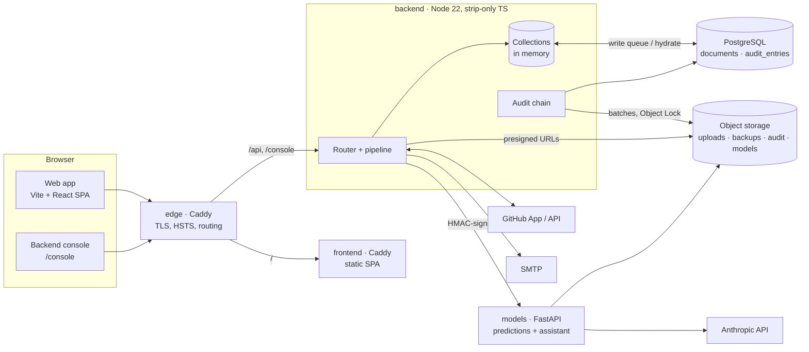
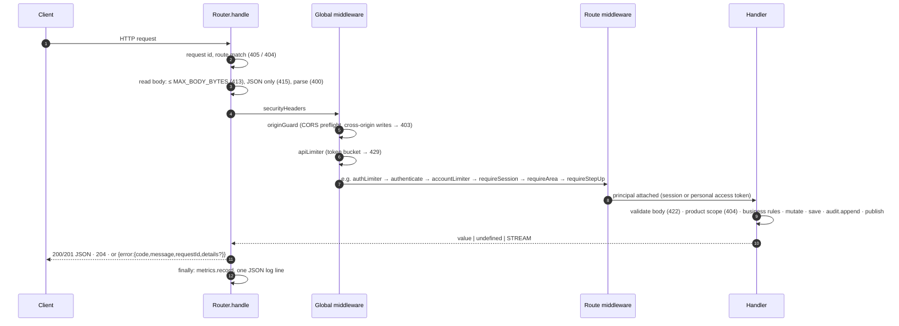
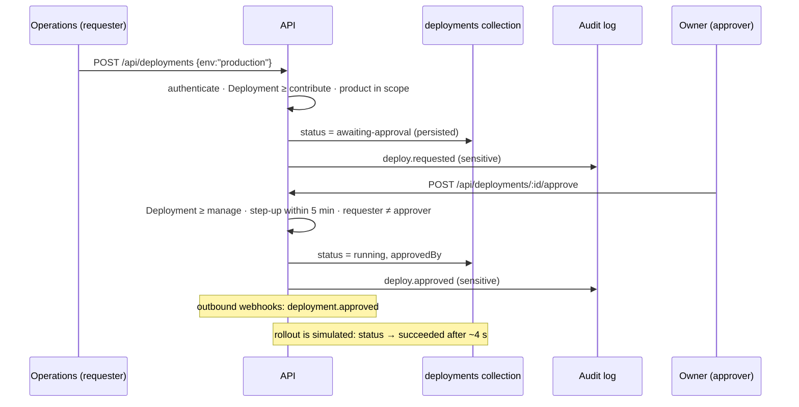
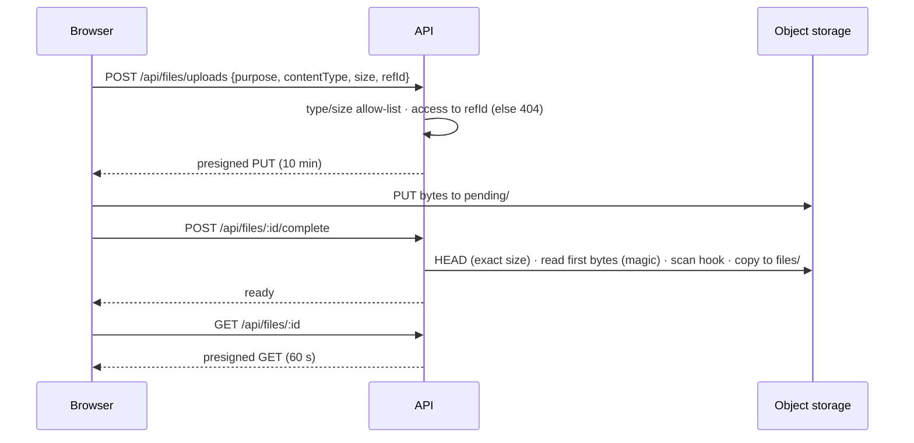

# Architecture overview

This page describes the application architecture: components, the request
pipeline, data flow and trust boundaries. The container topology, networks
and hardening are documented by the infrastructure lane in
[docs/deploy/ARCHITECTURE.md](../deploy/ARCHITECTURE.md); the threat model is
[docs/security/THREAT_MODEL.md](../security/THREAT_MODEL.md). Decisions and
their reasons are in the [ADRs](adr/index.md).

## Components

| Component | Where | Notes |
|---|---|---|
| API | `Backend/server.ts` | One Node process. `buildApp()` initialises persistence, builds the `Router`, installs the global middleware and registers 29 route modules (`Backend/routes/*.routes.ts`). No runtime npm dependencies except the PostgreSQL driver `pg`. |
| Router | `Backend/lib/http.ts` | A route table on `node:http`. `router.inventory()` is the API inventory, the OpenAPI document (`GET /api/openapi.json`) and the [API reference](../api/reference.md) — 181 routes. |
| Collections | `Backend/store/collection.ts`, `Backend/db/` | Every module's state is a `Collection` (a `Map`) read synchronously from memory and persisted to PostgreSQL through a write queue; loaded with `hydrateAll()` at boot ([ADR 0003](adr/0003-postgres-jsonb-collections.md)). Without `DATABASE_URL`, memory only. See [Storage](../operations/storage.md) and `Backend/db/README.md`. |
| Domains | `Backend/routes/`, `Backend/domain/collab/`, `Backend/domain/engineering/`, `Backend/monitors/`, `Backend/integrations/` | Core work (tasks, projects, docs, deployments, incidents, team), collaboration (channels, messages, workspaces, notifications, onboarding, recovery, offboarding, doc versions and comments), engineering (GitHub App, repositories, pull requests, CI, code findings, monitors, integrations, outbound webhooks). |
| Security | `Backend/auth/`, `Backend/security/`, `Backend/middleware/` | Sessions, TOTP, WebAuthn, RBAC, JIT grants, personal access tokens, rate limiting, headers and origin guard, event delivery policy, secret sealing. Controls map: [docs/security/CONTROLS.md](../security/CONTROLS.md). |
| Storage | `Backend/storage/` | S3 client with its own SigV4 signer, local fallback driver, presigned uploads, magic-byte checks, audit archive ([ADR 0004](adr/0004-s3-compatible-object-storage.md)). |
| Resilience | `Backend/resilience/` | Encrypted snapshots of every collection, restore with dry run, drills ([Backups](../operations/backups.md)). |
| Audit log | `Backend/audit/auditLog.ts` | Hash chain in memory, JSONL file, `audit_entries` table, WORM archive ([ADR 0008](adr/0008-hash-chained-audit-log.md)). |
| Realtime | `Backend/lib/events.ts`, `Backend/domain/collab/realtime.ts` | In-process event bus streamed per subscriber over `/api/_events`; collaboration events over `/api/stream` ([Realtime](../api/realtime.md)). |
| Mail | `Backend/mail/` | SMTP or console transport for recovery mail and notification digests. |
| ML service | `Models/` | Python FastAPI service on the internal network; the backend bridge is `Backend/integrations/ml/` ([ADR 0005](adr/0005-separate-python-ml-service.md), [ML](../ml/index.md)). |
| Backend console | `Backend/backend.html` | A single HTML page served by the API with a per-response CSP nonce. |
| Web app | `Frontend/` | React SPA. All API traffic goes through `Frontend/src/api/client.ts`, cookie only. |

## Request pipeline

Every request goes through the same steps, in this order
(`Router.handle` in `Backend/lib/http.ts`):

1. **Request id.** Taken from an incoming `X-Request-Id` (first 64 characters)
   or generated, and echoed in the `X-Request-Id` response header.
2. **Route match.** If the path exists but not for this method the response is
   `405 method_not_allowed` with an `Allow` header. An unknown path still runs
   the global middleware, then answers `404 not_found`.
3. **Body.** For a matched route and any method other than `GET`, `HEAD` and
   `DELETE`, the body is read *before* the middleware runs: more than
   `MAX_BODY_BYTES` → `413`; a non-empty body that is not `application/json`
   → `415`; malformed JSON → `400 invalid_json`. The raw bytes are kept for
   webhook signature checks.
4. **Security headers** (`Backend/security/headers.ts`): CSP with a fresh
   nonce, `X-Content-Type-Options`, `X-Frame-Options: DENY`, `Referrer-Policy`,
   `Permissions-Policy`, COOP/CORP, `Cache-Control: no-store`, and HSTS in
   production. Which header is set by which layer (edge, frontend server, backend) is
   tabulated in [docs/deploy/ARCHITECTURE.md](../deploy/ARCHITECTURE.md#headers-who-sets-what).
5. **Origin guard.** An `Origin` in `allowedOrigins` gets credentialed CORS
   headers. A preflight from any other origin is `403 bad_origin`; so is any
   non-`GET`/`HEAD` request that carries a disallowed `Origin`.
6. **API rate limit**, then the route's own middleware in order:
   `authLimiter` (keyed by IP and account), `authenticate` /
   `authenticatePartial` (session cookie, CLI bearer token or personal access
   token), `accountLimiter` (per member on second-factor routes),
   `requireSession` (refuses personal access tokens), `requireArea`
   (`403 forbidden`), `requireStepUp` (`401 step_up_required`). See
   [Rate limits](../api/rate-limits.md) and [Sessions](../concepts/sessions.md).
7. **Handler.** Validates the body against an allow-list schema, enforces
   product scope with `404`, applies domain rules, mutates the collection (and
   calls `save(key)` after in-place changes), appends an audit entry and
   publishes an event.
8. **Response and logging.** Thrown `HttpError`s become the
   [error envelope](../api/errors.md); anything else becomes `500 internal`
   and the stack trace goes only to the log. Per-route metrics and one log line
   are recorded for every request except the long-lived streams.

Server-level limits (`Backend/server.ts`): headers within 10 s, the whole
request within 30 s, keep-alive 5 s, at most 64 headers.

## Data flow: a production deploy

DevHQ records and approves deployments; it does not execute them
([ADR 0007](adr/0007-two-person-deploy-rule.md)).

## Data flow: a file upload

## Trust boundaries

| Boundary | What crosses it | What protects it |
|---|---|---|
| Internet → edge | HTTPS | TLS (Let's Encrypt), HSTS, only ports 80/443 published; the edge overwrites `X-Forwarded-For`. |
| Browser → API | Cookies, JSON bodies | `__Host-` cookie (`Secure`, `HttpOnly`, `SameSite=Strict`); origin allow-list; JSON-only bodies; size limit; allow-list validation; rate limits; CSP on HTML. The API enforces everything itself and does not trust the edge for security decisions. |
| Scripts → API | Personal access tokens | Hashed at rest, scoped, intersected with the live role, expiring, never step-up capable. |
| GitHub → API | Webhooks | HMAC over the raw body, replay protection by delivery id ([Webhooks](../api/webhooks.md)). |
| API → outbound URLs | Monitor checks, outbound webhooks | SSRF guard: DNS resolved and pinned, private/metadata ranges blocked, 10 s deadline, redirects re-checked (`Backend/monitors/ssrf.ts`). |
| API → models | Prediction and assistant requests | Internal network only; HMAC with timestamp and nonce; features stripped of names, emails, IPs and free text; data scoped before it leaves. |
| API → PostgreSQL / object storage | Records, blobs | Internal network; least-privilege database role and MinIO user (put-only on the audit bucket); Object Lock on backups and audit; app-level AES-256-GCM for secrets and backups. |
| Operator → console | Same as browser | Stricter console CSP (`script-src 'nonce-…'` only, `connect-src 'self'`, `form-action 'none'`). |

Network layout and container hardening:
[docs/deploy/ARCHITECTURE.md](../deploy/ARCHITECTURE.md#trust-boundaries).
