# JIT elevation (just-in-time production access)

Nobody except the Owner holds standing production rights. A member who needs
production access asks for a **grant**: one product, a reason, a duration. A
different person approves it, it expires on its own, and every step is in the
audit log (`Backend/auth/jit.ts`). Production-impacting actions are
**refused** without an approved, unexpired grant for that product
(`assertElevation` in `Backend/auth/rbac.ts`).

## Lifecycle

```mermaid
stateDiagram-v2
  [*] --> pending: request (step-up)
  pending --> active: approve — Owner/Operations, not the requester (step-up)
  pending --> denied: revoke — Deployment ≥ manage (step-up)
  active --> revoked: revoke — Deployment ≥ manage (step-up)
  active --> expired: duration elapsed (stops working at once; the sweeper records it within 15 s)
```



| Step | Route | Who | Checks |
|---|---|---|---|
| Request | `POST /api/access/grants` `{scope, reason, durationMinutes}` | any member | step-up; `scope` is `production:<product>` for a product in the caller's scope (`403 forbidden` otherwise, `422 scope_invalid` for an unknown scope); `reason` 10–500 characters; `durationMinutes` 15–480 |
| List | `GET /api/access/grants` | Administration ≥ `view` (Owner, Operations) | — |
| My grants | `GET /api/access/grants/mine` | any member | only the caller's own grants (pending, active, ended), newest first |
| Approve | `POST /api/access/grants/:grantId/approve` | Owner or Operations | step-up; not your own grant (`403 self_approval`); grant must be `pending` (`404 not_found` otherwise) |
| Revoke / deny | `POST /api/access/grants/:grantId/revoke` | Deployment ≥ `manage` | step-up; a pending grant becomes `denied`, an active one `revoked` |
| Expire | — | system | the grant stops working as soon as `expiresAt` passes; the sweeper then marks it `expired` and audits `jit.expired` |

The maximum duration is 8 hours. All grant events are audited as
`jit.requested`, `jit.approved`, `jit.denied`, `jit.revoked`, `jit.expired`
and `jit.used`, with `sensitive: true`. A new request notifies every active
Owner and Operations member in that product (`approval` notification linking
to `/security`).

## Example

Developer `m4` asks for an hour on RenewBerry production; trying to approve it
themself fails; Operations `m11` approves:

```console
$ curl -s -b dev -X POST http://localhost:8080/api/access/grants -H 'content-type: application/json' \
    -d '{"scope":"production:renewberry","reason":"Investigate INC-31 queue backlog","durationMinutes":60}'
{"id":"962MoLpGncwPDYjA","memberId":"m4","scope":"production:renewberry","reason":"Investigate INC-31 queue backlog","requestedAt":1794011821930,"durationMs":3600000,"status":"pending"}

$ curl -s -b dev -X POST http://localhost:8080/api/access/grants/962MoLpGncwPDYjA/approve
{"error":{"code":"self_approval","message":"You can’t approve your own access","requestId":"58f20686-…"}}

$ curl -s -b ops -X POST http://localhost:8080/api/access/grants/962MoLpGncwPDYjA/approve
{"id":"962MoLpGncwPDYjA","memberId":"m4","scope":"production:renewberry","reason":"Investigate INC-31 queue backlog","requestedAt":1794011821930,"durationMs":3600000,"status":"active","approvedBy":"m11","expiresAt":1794015422009}
```

(Both sessions were less than 5 minutes old, so the step-up requirement was
already met.)

From then on the developer's principal carries the elevation:

```console
$ curl -s -b dev http://localhost:8080/api/me/capabilities
{…,"elevations":["production:renewberry"]}
```

## What needs a grant

The scope is always `production:<product>`, the same string
`POST /api/access/grants` issues. The check runs in the route handler after the
role check, the `404` product-scope check and the two-person rule, and before
anything changes:

| Action | Route | Needs `production:<product>` when |
|---|---|---|
| Approve a deployment | `POST /api/deployments/:id/approve` | the deployment is production (only production deployments await approval) |
| Roll back a deployment | `POST /api/deployments/:id/rollback` | the deployment is production **and** was approved or ran (`running`, `succeeded`, `failed`). Rejecting a production request that is still `awaiting-approval` touches nothing live and needs no grant |
| Change an incident's severity | `PATCH /api/incidents/:id` with a `severity` different from the current one | always: incidents describe live services |
| Resolve a SEV1 | `PATCH /api/incidents/:id` with `status: "resolved"` | the incident is SEV1 |

Not gated: staging deployments (request, run, roll back), requesting a
production deploy (it waits for approval anyway), declaring an incident of any
severity, timeline notes and the other incident status moves
(`identified`, `monitoring`), and resolving a SEV2 or SEV3. Responders can
always work an incident; only the decisions above are production changes.

Who passes:

- **The Owner**, through `hasOwnerPowers` (standing production rights). No
  `jit.used` entry is written; the action's own audit entry names the Owner.
- **A member with a live grant** for the scope. Each use is audited as
  `jit.used` (sensitive), with the scope, the action and the grant id, for
  example `production:renewberry · deploy.approve d-1a2b · grant 962MoLpGncwPDYjA`.
- **Never a personal access token**, not even an Owner's with
  `organization:admin`: tokens never carry an elevation
  (`elevations` is always `[]` for a PAT principal) and are refused with
  `403 elevation_unavailable`. A grant is for a person in an interactive
  session; use the web app or a CLI session for production actions.

A refusal looks like this, so a client can offer "Request access" for exactly
that scope:

```json
{"error":{"code":"elevation_required","message":"Request just-in-time access for production:renewberry","requestId":"…","details":{"scope":"production:renewberry"}}}
```

### Expiry and revocation are immediate

`authenticate` rebuilds `Principal.elevations` from the grant store on every
request, keeping only grants that are `active` with `expiresAt > now`. So an
elapsed grant is refused on the next request even before the 15-second sweeper
marks it `expired`, and a revoked grant is refused on the very next request of
a live session. Nothing is cached and no restart or sign-in is needed.

`requireElevation(scopeOf)` is the route-guard form for a scope that follows
from the path alone; the routes above call `assertElevation` in the handler
because the scope depends on the stored deployment or incident.

## In the web app

- **Refused action → request dialog.** When an action comes back
  `403 elevation_required`, the app opens **Request production access** for
  the scope in `details.scope`, with a reason (10–500 characters) and a
  duration (15 minutes – 8 hours). It posts `POST /api/access/grants` and says
  "Access requested" only after the API accepts. If a request for that scope
  is already pending, the dialog says so instead of offering a duplicate
  (`Frontend/src/components/jit/`).
- **Where you act.** Deployment detail (for production deploys you can approve
  or roll back) and incident detail (while open) show your grant for that
  product: active with time left, pending, or a **Request access** button.
  The Owner sees nothing there.
- **Where approvers decide.** Security (`/security`) → **Production access**
  lists pending and active grants for Owner and Operations, with time left.
  Approve someone else's request (never your own), deny a pending one or revoke
  an active one, each after a re-verification. The Team page's **Access
  review** also lists pending grants. Other members see only their own grants
  there.

Grants are persisted (`jitGrants` collection), so they survive restarts.
Completing an offboarding, the `member.deactivated` event and deactivating a
member through `PATCH /api/team/:memberId` all revoke the member's grants
(`revokeStandingAccess` in `Backend/security/pats.ts`). The controls are listed
in [docs/security/CONTROLS.md](../security/CONTROLS.md) (C-24).
