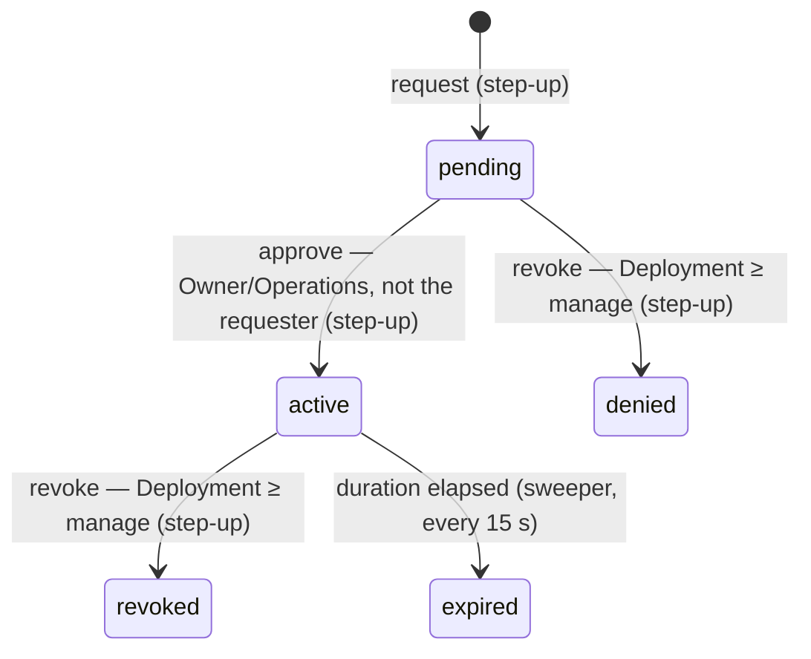

# JIT elevation (just-in-time production access)

Nobody except the Owner holds standing production rights. A member who needs
production access asks for a **grant**: one product, a reason, a duration. A
different person approves it, it expires on its own, and every step is in the
audit log (`Backend/auth/jit.ts`).

## Lifecycle



| Step | Route | Who | Checks |
|---|---|---|---|
| Request | `POST /api/access/grants` `{scope, reason, durationMinutes}` | any member | step-up; `scope` is `production:<product>` for a product in the caller's scope (`403 forbidden` otherwise, `422 scope_invalid` for an unknown scope); `reason` 10–500 characters; `durationMinutes` 15–480 |
| List | `GET /api/access/grants` | Administration ≥ `view` (Owner, Operations) | — |
| Approve | `POST /api/access/grants/:grantId/approve` | Owner or Operations | step-up; not your own grant (`403 self_approval`); grant must be `pending` (`404 not_found` otherwise) |
| Revoke / deny | `POST /api/access/grants/:grantId/revoke` | Deployment ≥ `manage` | step-up; a pending grant becomes `denied`, an active one `revoked` |
| Expire | — | system | the sweeper marks an active grant `expired` once `expiresAt` passes and audits `jit.expired` |

The maximum duration is 8 hours. All grant events are audited as
`jit.requested`, `jit.approved`, `jit.denied`, `jit.revoked`, `jit.expired`,
with `sensitive: true`.

## Example

Developer `m4` asks for an hour on RenewBerry production; trying to approve it
themself fails; Operations `m11` approves:

```console
$ curl -s -b dev -X POST http://localhost:8080/api/access/grants -H 'content-type: application/json' \
    -d '{"scope":"production:renewberry","reason":"Investigate INC-31 queue backlog","durationMinutes":60}'
{"id":"962MoLpGncwPDYjA","memberId":"m4","scope":"production:renewberry","reason":"Investigate INC-31 queue backlog","requestedAt":1794011821930,"durationMs":3600000,"status":"pending"}

$ curl -s -b dev -X POST http://localhost:8080/api/access/grants/962MoLpGncwPDYjA/approve
{"error":{"code":"self_approval","message":"You can’t approve your own access","requestId":"58f20686-…"}}

$ curl -s -b ops -X POST http://localhost:8080/api/access/grants/962MoLpGncwPDYjA/approve
{"id":"962MoLpGncwPDYjA","memberId":"m4","scope":"production:renewberry","reason":"Investigate INC-31 queue backlog","requestedAt":1794011821930,"durationMs":3600000,"status":"active","approvedBy":"m11","expiresAt":1794015422009}
```

(Both sessions were less than 5 minutes old, so the step-up requirement was
already met.)

From then on the developer's principal carries the elevation:

```console
$ curl -s -b dev http://localhost:8080/api/me/capabilities
{…,"elevations":["production:renewberry"]}
```

## What an elevation unlocks today

Nothing on the API yet. `requireElevation(scopeOf)` exists in
`Backend/auth/rbac.ts` to guard routes that need an active grant (the Owner
always passes), but no route uses it. Elevations are visible in
`GET /api/auth/session`, `GET /api/me/capabilities`, the Team page's access
review and the console. They become meaningful when production-touching
routes (infrastructure actions, database access, production shells) are
added and guarded with it.

## In the web app

The Team page's **Access review** lists pending grants next to members without
a second factor, and approves or denies them through the routes above after a
re-verification (`Frontend/src/components/team/AccessReview.tsx`).

Grants are persisted (`jitGrants` collection), so they survive restarts.
Completing an offboarding revokes the member's grants; deactivating a member
through `PATCH /api/team/:memberId` does not yet (listed in
[docs/security/CONTROLS.md](../security/CONTROLS.md#known-gaps--follow-ups)).
