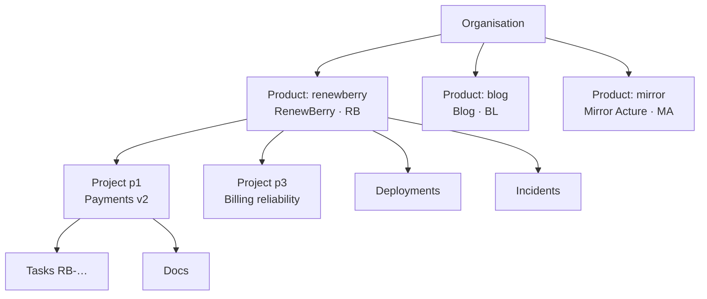

# Products, projects and scope

## The hierarchy



- **Products** are fixed: `renewberry`, `blog` and `mirror`
  (`ProductId` in `Backend/types.ts`). Display names and the task-key prefix
  live in the API (`PRODUCTS` in `Backend/routes/projects.routes.ts`) so the
  browser does not keep a second catalogue.
- **Projects** belong to exactly one product (`p1`–`p7` in the seed). Tasks
  and docs belong to a project and inherit its product.
- **Tasks** are keyed by product prefix and a number (`RB-212`, `BL-26`,
  `MA-…`). A new task gets the next free number for its product.
- **Deployments** and **incidents** belong to a product directly.
- **Members** are assigned to one or more products (`Member.products`).

## Scope

A member's **scope** is the set of products they are assigned to. The Owner's
scope is every product, whatever `products` says (`canSeeProduct` in
`Backend/auth/rbac.ts`).

Scope is applied on the server, on every request, before anything leaves the
API:

- **Lists** are filtered to the caller's products: tasks, projects, docs,
  deployments, incidents, the team directory, `/api/products`, `/api/scope`,
  and the console query runner's collections (except `audit`).
- **Single resources** outside the caller's scope answer **`404 not_found`**,
  never `403`, so a member cannot learn that a task, doc, deployment or
  incident exists in a product they do not work on (`assertProduct`,
  `visibleTask`, and the explicit checks in the route files).
- **Writes** check scope too: creating a task, doc, deployment or incident in
  a product outside your scope is `404`; assigning a task to someone who is
  not an active member of that product is `422 assignee_invalid`.

Real responses, Developer `m4` (scope: renewberry):

```console
$ curl -s -b dev http://localhost:8080/api/tasks/BL-26
{"error":{"code":"not_found","message":"Not found","requestId":"9f88bc6f-…"}}
$ curl -s -b dev 'http://localhost:8080/api/tasks?limit=1'
{"total":7,"limit":1,"offset":0,"items":[{"key":"RB-209","title":"Billing webhook deduplication","product":"renewberry",…}]}
```

### Restricted docs

A doc has a `visibility` of `project`, `workspace` or `restricted`. A
`restricted` doc is readable only by its `editors` and by the Owner, on top of
the product check (`readable()` in `Backend/routes/docs.routes.ts`). Editing a
doc adds you to its editors.

### The scope picker

The web app's product/project picker hydrates from `GET /api/scope`, which
returns only the products and projects the caller may scope to. Choosing a
product in the picker only narrows what the UI shows; it never widens what the
API returns.

## What scope does not cover today

- The audit trail (`GET /api/audit`), logs and metrics are not
  product-scoped (the event stream `/api/_events` is). See
  [Roles and permissions](roles-and-permissions.md#routes-open-to-every-signed-in-member).
- Location data is scoped by person instead: members see their own sign-ins
  and sessions; Administration ≥ `view` sees everyone's.

## Scope in the other modules

The same rules apply to every module: repositories, pull requests, CI runs
and code findings are scoped by the repository's product; monitors and
integrations by their product; files by the resource they are attached to;
channels by membership, privacy and product. Anything out of scope answers
`404`. Realtime events are filtered the same way at delivery time
([Realtime](../api/realtime.md)). Personal access tokens additionally narrow
what a member can do, never what they can see beyond their products.
