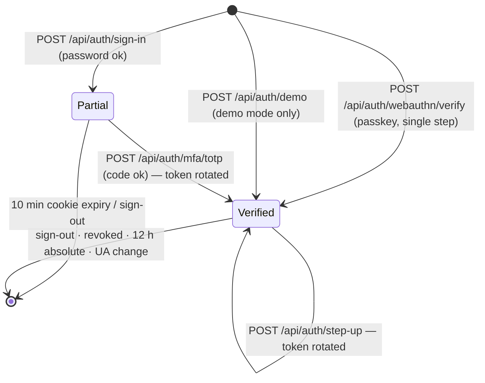

# Sessions and continuous verification

A session is created at sign-in and checked again on **every** request. Trust
is not granted once and assumed until logout.

## Signing in



1. **Password** (`POST /api/auth/sign-in`). An unknown email and a wrong
   password produce the same `401 invalid_credentials`, and the unknown-email
   path still runs a full password hash so the timing matches. Five
   consecutive failures lock the account for 15 minutes (`423 locked`). The
   location risk engine runs on the successful attempt and can block it
   (`403 risk_blocked`; see [Location risk](location-risk.md)). On success the
   member gets a **partial** session (cookie `Max-Age` 10 minutes) and the
   response says which second factors are available:

   ```json
   {"next":"totp","methods":["totp"]}
   ```

2. **Second factor.** `POST /api/auth/mfa/totp` with a 6-digit code (RFC 6238,
   30-second steps; a code cannot be replayed within the same session), or a
   passkey through `POST /api/auth/webauthn/options` + `/verify`. Success
   **rotates** the session: a new token is issued and the partial one is
   revoked, which prevents session fixation. In demo mode the shared code
   `246810` is accepted for every account.

3. A partial session can reach only `GET /api/auth/pending`,
   `POST /api/auth/mfa/totp` and `POST /api/auth/sign-out`. Anything else
   answers `401 mfa_required`.

Passwords are hashed with scrypt (N = 2¹⁵, r = 8, p = 1, 64-byte key, random
salt) in the format `scrypt-v1$N$r$p$salt$hash`; a hash with older parameters
is upgraded on the next successful sign-in (`Backend/security/crypto.ts`).

## The token

The session id is 32 random bytes. The token sent to clients is the id plus an
HMAC over it with `SESSION_SECRET` (`signToken` in
`Backend/security/crypto.ts`), so a forged or altered token is rejected before
any lookup (`401 invalid_token`). `SESSION_SECRET_PREVIOUS` is accepted for
verification only, so the key can be rotated without signing everyone out.

Browsers receive it as `__Host-devhq_session` (`HttpOnly`, `Secure`,
`SameSite=Strict`, `Path=/`); other clients can send
`Authorization: Bearer <token>`. See
[Authentication](../api/authentication.md) and
[ADR 0006](../architecture/adr/0006-cookie-only-browser-sessions.md).

## Checks on every request

`validateSession()` in `Backend/auth/sessions.ts`, called by `authenticate`:

| Check | Outcome when it fails |
|---|---|
| HMAC valid | `401 invalid_token` |
| Session exists and is not revoked | `401 session_revoked` |
| Younger than the absolute lifetime (`SESSION_ABSOLUTE_MS`, 12 h) | revoked, `401 session_expired` |
| Used within the idle timeout (`SESSION_IDLE_MS`, 15 min) | session kept, but `verifiedAt` cleared → next sensitive action needs step-up |
| Same `User-Agent` as at sign-in (compared as a SHA-256 hash) | revoked, `401 session_context_changed` |
| Same client IP as last request | session kept, IP and location updated, `verifiedAt` cleared → step-up |
| Member exists and is `active` | `401 account_inactive` |
| Session has passed MFA (for full routes) | `401 mfa_required` |

When `verifiedAt` has been cleared the response carries
`X-Step-Up-Required: 1`, so clients can prompt before the user tries a
sensitive action. The web app's lock screen maps to the idle case.

A user-agent change is treated as token theft:

```console
$ curl -s -b dev -A 'other-agent/1.0' http://localhost:8080/api/auth/session
{"error":{"code":"session_context_changed","message":"Session used from a different device — signed out for safety","requestId":"d8fdb6f3-…"}}
$ curl -s -b dev http://localhost:8080/api/auth/session
{"error":{"code":"session_revoked","message":"Session ended","requestId":"fe9c12b2-…"}}
```

## Seeing and ending sessions

- `GET /api/auth/session` returns the member, `stepUpRequired`, active
  elevations, the member's sessions and the request's location. Session ids
  are shown as an 8-character handle that cannot be used as a credential.
- `DELETE /api/auth/sessions/:sessionPrefix` revokes one of your sessions by
  that handle.
- `POST /api/auth/sign-out` ends the current session and clears the cookie;
  `POST /api/auth/sign-out-everywhere` revokes all of yours.
- `GET /api/locations/sessions` lists live sessions with location: your own,
  or everyone's with Administration ≥ `view`.
- An admin changing your role, products or status revokes all of your sessions.
- Expired sessions are swept every 5 minutes.

## Where sessions live

In a `Map` inside the API process. A restart signs everyone out.

> [!NOTE]
> **Planned: Wave 4 (B-DATA, SEC, F-SEC).** Sessions, sign-in records and JIT
> grants are persisted in PostgreSQL, so they survive restarts. Real WebAuthn
> for sign-in, step-up and lock-screen unlock goes through the existing
> `/api/auth/webauthn/*` and `/api/auth/passkeys*` routes, and TOTP enrolment
> is added (`POST /api/auth/totp/enroll` and `/api/auth/totp/confirm`, secret
> encrypted at rest with `DATA_ENCRYPTION_KEY`). Today a member has a TOTP
> secret only if `DEMO_TOTP_SECRET` is set, and there is no enrolment route.
