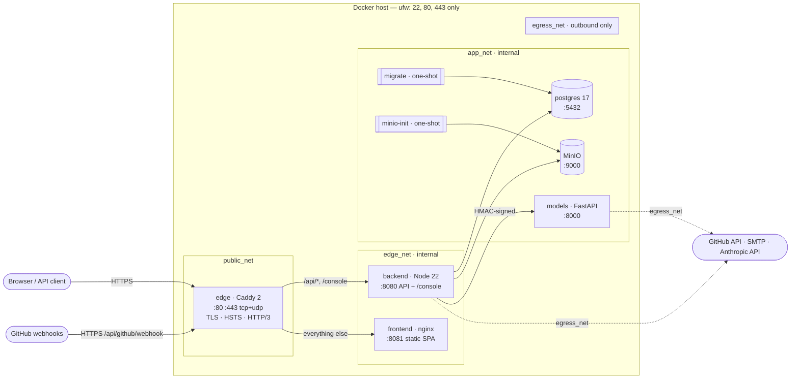

# DevHQ deployment architecture

One host, Docker Compose, everything behind a single edge. Source of truth:
`docker-compose.yml` (prod-like) and `docker-compose.dev.yml` (dev override).

## Services and networks



ASCII view of the same thing:

```
 Internet ──443/tcp+udp, 80──▶ [edge: Caddy]              public_net (published)
                                   │  TLS ends here; XFF overwritten
                 ┌─────────────────┴─────────────────┐    edge_net (internal)
                 ▼                                   ▼
       [frontend: nginx :8081]            [backend: node :8080] ──▶ egress_net ──▶ GitHub/SMTP
                                                     │
                 ┌───────────────┬───────────────────┼──────────────┐  app_net (internal)
                 ▼               ▼                   ▼              ▼
          [postgres :5432]  [minio :9000]     [models :8000] ──▶ egress_net ──▶ Anthropic
                 ▲               ▲
            [migrate]      [minio-init]        (one-shot, before backend)
```

| Network | `internal` | Members | Why |
|---|---|---|---|
| `public_net` | no | edge | the only network with published ports; ACME egress |
| `edge_net` | yes | edge, frontend, backend | edge reaches upstreams; upstreams cannot reach the internet through it |
| `app_net` | yes | backend, migrate, postgres, minio, minio-init, models | data plane; no route out, never published |
| `egress_net` | no | backend, models | outbound calls only; nothing listens on it |

The dev override sets `edge_net`/`app_net` to non-internal so ports can be
published on `127.0.0.1` for host tools.

## Trust boundaries

1. **Internet → edge.** Only TLS (and an HTTP→HTTPS redirect) is accepted.
   Caddy enforces header/body size limits and read timeouts, adds HSTS, strips
   `Server`, and **overwrites** `X-Forwarded-For` / `X-Real-IP` with the TCP
   peer address (drops `Forwarded`). No upstream proxy is trusted, so a
   client cannot spoof its IP.
2. **Edge → backend.** The backend runs with `TRUST_PROXY=1` and takes the
   first XFF entry, which is always the edge's value. It still enforces
   everything that must hold if the edge is bypassed: security headers, CSRF
   origin checks, rate limits, authn/z, validation, audit.
3. **Same origin.** The SPA and `/api` share one origin, so the `__Host-`
   `SameSite=Strict` session cookie works with no CORS.
4. **Backend → data plane.** Postgres, MinIO and models are reachable only on
   `app_net`. The backend connects to Postgres as `devhq_app` (DML only); the
   one-shot `migrate` service uses the schema owner `devhq`. MinIO access uses
   a bucket-scoped application user, never the root credentials. Calls to
   `models` are HMAC-signed with `ML_SERVICE_TOKEN`.
5. **Secrets.** Files in `infra/secrets/` (0700 dir, 0640 files), mounted per
   service at `/run/secrets/<name>`; each container receives only the secrets
   it needs. Never in images, compose env or git.

## Container hardening (every service)

`read_only: true` root filesystem with tmpfs for scratch paths, `cap_drop:
[ALL]`, `no-new-privileges`, non-root uid (backend 10001, edge 10002, nginx
101, postgres 70, MinIO 65532), CPU/memory/pids limits, healthchecks with
`depends_on: service_healthy`, `restart: unless-stopped`, json-file log
rotation (5 × 10 MB). The edge binds :80/:443 without
`CAP_NET_BIND_SERVICE` through the namespaced sysctl
`net.ipv4.ip_unprivileged_port_start=0`.

## Startup order

`postgres` (healthy) → `migrate` (exit 0) ┐
`minio` (healthy) → `minio-init` (exit 0) ┼→ `backend` (healthy) ┐
`frontend` (healthy) ─────────────────────┴──────────────────────┴→ `edge`

`models` starts independently; the backend degrades to heuristics when it is
unavailable.

## Images and supply chain

| Image | Base (pinned by digest) | Notes |
|---|---|---|
| backend | `node:22-alpine` | `npm ci --omit=dev --ignore-scripts`; npm/corepack removed from runtime; tini; `*_FILE` entrypoint |
| frontend | `node:22-alpine` → `nginxinc/nginx-unprivileged:1.29-alpine` | pre-gzipped assets, SPA fallback, CSP |
| edge | `caddy:2.10-alpine` | file capability stripped, non-root |
| models | ML lane (`Models/Dockerfile`) | |
| postgres | `postgres:17-alpine` | |
| minio, minio-init | `cgr.dev/chainguard/minio{,-client}:latest-dev` | MinIO stopped publishing images to Docker Hub/Quay |

CI (`images.yml`) builds each image, gates on Trivy (HIGH/CRITICAL with a
fix), and on `develop`/`main`/`v*` pushes to GHCR by full-SHA tag, generates a
Syft SPDX SBOM, signs with cosign keyless, and attaches SBOM + SLSA build
provenance attestations. `deploy.yml` verifies the signatures before rolling
out.

## Headers: who sets what

| Header | SPA (nginx) | API (backend) | Edge |
|---|---|---|---|
| `Strict-Transport-Security` | — | prod only | always (single source) |
| `Content-Security-Policy` | `infra/nginx/security-headers.conf` | `Backend/security/headers.ts` | — |
| nosniff, frame DENY, referrer, permissions, COOP, CORP | yes | yes | — |
| `Cache-Control` | `immutable` for `/assets/*`, `no-cache` for the shell | `no-store` | — |

The SPA's CSP adds what the bundle needs beyond the API policy: Google Fonts,
jsDelivr (Monaco loader) and `worker-src blob:` (code runner).
