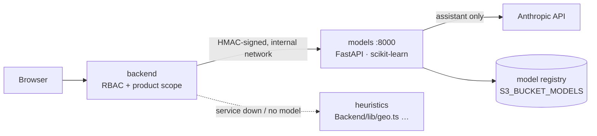

# ML and the assistant

DevHQ has a separate Python service for predictions and the assistant
([ADR 0005](../architecture/adr/0005-separate-python-ml-service.md)). Its own
guide — quick start, configuration, the service API, request signing, the
training pipeline, **model cards** and the assistant's design — is
**[Models/README.md](../../Models/README.md)**. This page is the overview from
the platform's side.



## What it provides

| Capability | Backend route (guard) | Model | Fallback |
|---|---|---|---|
| Task ETA (p10/p50/p90 days) and overdue risk | `GET /api/insights/tasks/:key` (Project ≥ `view`) | quantile gradient boosting; calibrated classifier | estimate- and due-date heuristics |
| Deployment risk | `GET /api/insights/deployments/:id` (Deployment ≥ `view`) | calibrated classifier | heuristic |
| Sign-in anomaly | `GET /api/insights/signins/:id` (own sign-ins; everyone's with Administration ≥ `view`) | IsolationForest per organisation | the rules in `Backend/lib/geo.ts` |
| Assistant | `POST /api/assistant/ask {question, scope?}` (Project ≥ `view`, per-member rate limit) | Anthropic API (`ASSISTANT_MODEL`, default `claude-sonnet-5-5`) | `503 integration_unconfigured` |
| Service status | `GET /api/insights/status` (Administration ≥ `view`) | — | — |
| Training | `POST /api/insights/train/:model` (Administration ≥ `admin` + step-up) | — | — |

Every insight says where it came from:

```console
$ curl -s -b owner http://localhost:8080/api/insights/tasks/RB-212
{"key":"RB-212","source":"heuristic","fallbackReason":"unconfigured","eta":{"p10":0.3,"p50":0.5,"p90":0.9,"date":"2026-11-07"},"overdue":{"probability":0.95,"drivers":["Already 9 days past due"]}}
```

`source` is `model` or `heuristic`; `fallbackReason` explains a heuristic
answer (here: no `ML_SERVICE_URL`). Model answers include `trainedOn`, which is
`"synthetic"` for cold-start models; the web app must show that.

## Rules that hold

- **Scope before data leaves.** The backend gathers only the records the
  caller could open through the normal routes, strips identifying fields from
  prediction features (no names, emails, IPs, cities or free text), and only
  then calls the service. The browser never talks to it.
- **Signed requests.** Every call carries `X-DevHQ-Signature`,
  `X-DevHQ-Timestamp` and `X-DevHQ-Nonce` (HMAC-SHA256 with
  `ML_SERVICE_TOKEN`, 5-minute skew, replay cache). Signing code:
  `Backend/integrations/ml/signing.ts`.
- **Fail closed on artefacts.** A model is loaded only after its signatures,
  checksum, feature list and library version check out; a tampered artefact
  makes that endpoint answer `503 model_unavailable`, and the backend falls
  back to heuristics.
- **Advisory only.** Scores never gate anything on their own: sign-ins are
  still decided by the rule engine, and deploys by the two-person rule.
- **Assistant output is untrusted.** It is rendered as text with its cited
  sources; cited ids are filtered to what was actually retrieved. The backend
  audits each question's length, source count and outcome, never its content.

## Limits

Models are synthetic until your organisation has enough real, labelled
history to pass the promotion gate. Read the model cards before relying on any
score, and the [known limits](../operations/known-limits.md#ml-models-are-synthetic-until-there-is-real-history).
