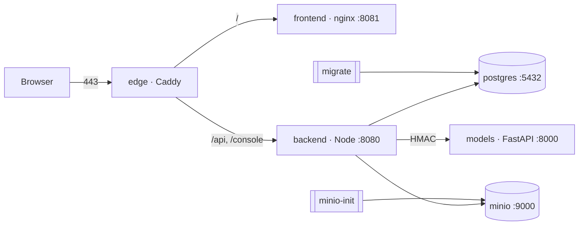

# Deployment and first run

DevHQ runs as one Docker Compose stack on a single host. The deployment
documents are owned by the infrastructure lane and are the source of truth;
this page links them and adds the application-side first-run steps.

| Document | Covers |
|---|---|
| [docs/deploy/RUNBOOK.md](../deploy/RUNBOOK.md) | host hardening, Docker, secrets, DNS/TLS, routine deploys and rollback, database backups and restore, secret rotation, scaling notes, incident checklist |
| [docs/deploy/ARCHITECTURE.md](../deploy/ARCHITECTURE.md) | services, networks, trust boundaries, container hardening, start-up order, image supply chain, which layer sets which header |
| [README.md](../../README.md) | quick start (`make secrets`, `make up`, `make up-dev`) and the `make` targets |
| [infra/secrets/README.md](../../infra/secrets/README.md) | the secret files `make secrets` generates |
| [infra/minio/README.md](../../infra/minio/README.md) | buckets, object lock, service users, AWS S3 / R2 equivalents |

## The stack



Only the edge publishes ports. `migrate` and `minio-init` are one-shot
services that run before the backend. Secrets are mounted as files and read
through `NAME_FILE` variables (`infra/docker/entrypoint.sh` for the backend,
`_secret()` in the models service).

## First-run production setup

A production database starts empty: production never seeds demo data or demo
accounts, so nobody can sign in until the first Owner is created. On a host
prepared as in the runbook (sections 1.1–1.6):

**1. Secrets and configuration.**

```bash
make secrets          # infra/secrets/* (mode 0700/0640) and .env; idempotent
$EDITOR .env          # DEVHQ_DOMAIN, ACME_EMAIL, image prefix/tag, SMTP_*, GITHUB_APP_ID …
```

Copy the generated `backup_encryption_key` file (in `infra/secrets/`) to your password manager now;
without it, database backups cannot be decrypted. Keep `DEMO_DISABLED=1` and
leave every other `DEMO_*` variable unset: in production the backend refuses
to start if any `DEMO_*` setting other than `DEMO_DISABLED` is non-empty.

**2. Start the stack and wait for it to be healthy.**

```bash
docker compose up -d --wait
```

`GET /api/ready` returns `200` with `"bootstrapRequired": true` while there are
no members: an empty production database is still "ready", so the deploy gate
passes.

**3. Create the first Owner.** Stop the backend first: every backend process
holds its own in-memory view of the collections, and a running server would
not see a row written by another process until it restarts.

```bash
docker compose stop backend
docker compose run --rm --no-deps backend node --run bootstrap-owner -- \
  --email you@your-org.example --name "Your Name"
docker compose up -d backend
```

The command (`Backend/scripts/bootstrap-owner.ts`) creates the member in the
`invited` state with all three products, audits `team.owner_bootstrapped`, and
prints a single-use invite link valid for 7 days:

```text
First Owner Your Name <you@your-org.example> created as m1.
Single-use invite link (expires 2026-11-14T…Z):
  https://devhq.example/accept-invite?token=…
```

It refuses to run when an active Owner already exists, so it cannot mint an
extra Owner on a live system.

**4. Accept the invite.** Open the link, set a password (at least 12
characters, upper and lower case, a digit and a symbol, not containing the
name part of your email).

**5. Enrol an authenticator.** Sign in with the new password. A member with no
second factor gets `{"next":"enroll","methods":[],"enrollRequired":true}`, and
the partial session may enrol a first authenticator:

- `POST /api/auth/mfa/enroll` → `{secret, otpauthUri, expiresAt, expiresInSec}`
  (the enrolment is valid for 10 minutes);
- add the secret or the `otpauth://` URI to an authenticator app;
- `POST /api/auth/mfa/enroll/confirm {"code":"123456"}` → the session is
  verified and rotated.

> [!WARNING]
> The web app's **Verify** screen does not yet offer this enrolment step
> (`Frontend/src/pages/auth/Verify.tsx` has no call to `/api/auth/mfa/enroll`).
> Until it does, enrol through the API, then sign in to the web app normally
> with the authenticator code. Through the edge, with a cookie jar:
>
> ```bash
> B=https://devhq.example
> curl -s -c jar -b jar -X POST $B/api/auth/sign-in -H 'content-type: application/json' \
>   -d '{"email":"you@your-org.example","password":"…"}'
> curl -s -c jar -b jar -X POST $B/api/auth/mfa/enroll -H 'content-type: application/json'
> #  → add "secret" to your authenticator app, then:
> curl -s -c jar -b jar -X POST $B/api/auth/mfa/enroll/confirm -H 'content-type: application/json' \
>   -d '{"code":"<6 digits>"}'
> rm jar
> ```
>
> This exact sequence (sign-in → `enrollRequired` → enrol → confirm) was run
> against a local backend for an invited member; the demo MFA code was refused
> for that member, as it should be.

**6. Add a passkey** (recommended) from the Security Center, then invite
everyone else from **Team & roles**. See [Admin tasks](../user-guide/admin-tasks.md).

## Routine operation

Deploys, rollbacks, database backups and restores, secret rotation and the
incident checklist are in the [runbook](../deploy/RUNBOOK.md). Application-level
backups and the restore API are in [Backups and restore](backups.md); object
storage is in [Storage](storage.md). Limits you should know before going live
are in [Known limits](known-limits.md).
